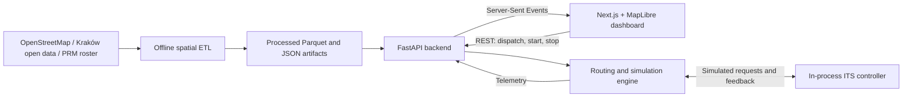

<p align="center">
  
</p>

<h1 align="center">ER-GreenWave</h1>

<p align="center">
  Emergency vehicle routing and traffic-signal preemption simulation for Kraków.
</p>

<p align="center">
  <a href="LICENSE"></a>
  <a href="https://github.com/fjarmula/GreenWave/actions/workflows/ci.yml"></a>
  <a href="frontend/package.json"></a>
  <a href="backend/pyproject.toml"></a>
  <a href="backend/pyproject.toml"></a>
</p>

<p align="center">
  <strong>Live Demo:</strong>
  <a href="https://green-wave.duckdns.org/">green-wave.duckdns.org</a>
</p>

<p align="center">
  <a href="#project-overview">Overview</a> ·
  <a href="#key-features--operating-modes">Features</a> ·
  <a href="#local-installation--setup">Installation</a> ·
  <a href="#usage--simulation-guide">Simulation guide</a> ·
  <a href="https://green-wave.duckdns.org/docs">Interactive documentation</a>
</p>

## Project Overview

ER-GreenWave (**Emergency Response GreenWave**) is a proof-of-concept platform for emergency vehicle routing and traffic-signal
preemption simulation in Kraków, developed for the city's **Open Data App** contest. It combines
OpenStreetMap road and signal geometry, municipal address data, and emergency-service base data
to select a dispatch origin, calculate a route, and compare journeys with and without coordinated
signal priority.

The application exposes the complete simulated workflow: incident selection, station ranking,
route preview, priority requests, controller feedback, vehicle movement, and travel-time results.
A bilingual Polish/English dashboard supports dispatch, live comparison, diagnostics, and a
compact driver view.

> [!IMPORTANT]
> **Simulation only.** ER-GreenWave does not connect to or control real traffic infrastructure.
> All signal states, ITS messages, vehicle movements, and priority commands are simulated.
> Results demonstrate the model's behavior; they are not validated operational response times.

## The Problem & Solution

An emergency vehicle approaching an ordinary signalised intersection may encounter stationary
queues, conflicting traffic, and blocked downstream exits. Route selection alone cannot prepare
those intersections. Traffic yielding around the vehicle can also disrupt adjacent movements and
shift congestion to the next junction.

ER-GreenWave explores a coordinated **green corridor**: prepare intersections before arrival,
give the emergency vehicle signal priority during passage, and restore ordinary operation
afterwards. Routing and time-to-intersection estimates determine when requests are submitted;
optional cascade coordination groups nearby intersections along the route.

The intended outcome is faster emergency response with less disruption to general traffic.
The current PoC models emergency-vehicle travel and signal behavior, **not individual traffic
queues, queue discharge, or network-wide congestion reduction**.

## Key Features / Operating Modes

### Traffic-signal operating modes

Intersection phases are separate from the run-level **GreenWave** (`ENABLED`) and
**Standard Traffic** (`DISABLED`) choices.

| Mode                                   | Traffic-management objective                                                                                              | Implemented simulation behavior                                                                                                                                                                                                                           |
| -------------------------------------- | ------------------------------------------------------------------------------------------------------------------------- | --------------------------------------------------------------------------------------------------------------------------------------------------------------------------------------------------------------------------------------------------------- |
| **Normal Mode** (`NORMAL`)             | Serve ordinary traffic without an active emergency corridor.                                                              | A simulated two-group signal programme. A pending priority request alone does not change the reported signals.                                                                                                                                            |
| **Clearing Mode** (`CLEARING`)         | Pre-emptive traffic flushing ahead of the emergency vehicle: prepare the corridor and downstream capacity before arrival. | Requests become eligible at time to intersection (TTI) ≤40 seconds by default. After acceptance, conflicting movements and pedestrians target red while route movements retain their ordinary programme. Queue flushing itself is not simulated.          |
| **Green Wave Mode** (`PRIORITY_GREEN`) | Provide signal priority at the intersection for emergency passage.                                                        | Requires an accepted request, TTI ≤25 seconds by default, and confirmation that supported route vehicle signals are shown green. Late feedback can still hold the vehicle at a stop line.                                                                 |
| **Recovery Mode** (`RECOVERY`)         | Smooth restoration of signal cycles after passage to prevent secondary gridlock.                                          | The ordinary programme resumes immediately after protected passage, subject to shown-head clearance transitions and interlocks. The recovery state lasts 15 seconds by default; gradual cycle/offset restoration and secondary gridlock are not modelled. |

### Simulation and analysis features

- **Incident-to-route dispatch:** select an incident on the map or search local address points;
  rank bases for ambulance, fire, or police response and preview the selected route.
- **Live GreenWave versus Standard Traffic comparison:** run the same scenario simultaneously
  on one simulated clock, with two maps and a final comparison of actual simulated travel times.
- **Cascade coordination:** group consecutive route intersections with along-route stop-line
  spacing of up to 250 metres, using precomputed neighbour candidates.
- **Simulated ITS feedback:** exercise nominal, delayed, rejected, unanswered, and seeded mixed
  controller responses. Failed requests switch their affected junctions to ordinary-signal
  fallback while the run continues.
- **Team-aware ambulance dispatch:** optionally consider published Małopolska PRM team shifts,
  operating areas, and simulated availability at a selected scenario time. This is not live
  emergency-service availability.
- **Off-road incident handling:** represent the final walk from vehicle access to the incident;
  handle on-site incidents without inventing a driving route.
- **Live telemetry and diagnostics:** inspect vehicle position, signal phases, priority-request
  status, observed API/SSE payloads, and dataset-quality summaries.
- **Responsive workspaces:** Polish/English copy, light/dark themes, map-follow controls,
  Focus Mode, and a phone-oriented driver view without a geolocation requirement.

## Tech Stack

| Layer                    | Technologies                                                                          | Responsibility                                                                      |
| ------------------------ | ------------------------------------------------------------------------------------- | ----------------------------------------------------------------------------------- |
| Frontend                 | Next.js 16.4.2, React 19.3, TypeScript, Tailwind CSS 4                                | App Router workspaces, controls, state, and telemetry presentation                  |
| Mapping                  | MapLibre GL JS                                                                        | Interactive WebGL maps, routes, vehicles, and signal overlays                       |
| Backend                  | Python 3.12+, FastAPI, Uvicorn, Pydantic v2                                           | Validated REST API, simulation lifecycle, and SSE telemetry                         |
| Spatial data and routing | GeoPandas, Shapely, Polars, NetworkX, Parquet                                         | Offline GIS processing, directed road graph, spatial operations, and route planning |
| Contracts                | OpenAPI, openapi-typescript                                                           | Generated frontend types from canonical backend Pydantic schemas                    |
| Infrastructure           | Docker Compose, Caddy, Oracle Cloud VM                                                | Local container workflow and documented public HTTPS deployment                     |
| Quality and tooling      | uv, npm, Ruff, mypy, pytest, ESLint, Prettier, Vitest, Playwright CLI, GitHub Actions | Dependency management, static checks, tests, browser verification, and CI           |

Exact dependency constraints and resolved versions are recorded in
[`backend/pyproject.toml`](backend/pyproject.toml), [`backend/uv.lock`](backend/uv.lock),
[`frontend/package.json`](frontend/package.json), and
[`frontend/package-lock.json`](frontend/package-lock.json).

## Architecture Overview



The offline ETL builds a directed road network and tables for intersections, signal approaches,
neighbours, stations, addresses, and resources. Spatial calculations use **EPSG:2178** metric
coordinates; API and map positions use WGS84. At startup, the backend loads these artifacts once
and validates their schemas, references, and recorded hashes. Incomplete or inconsistent data
prevents startup.

The dashboard uses REST for dispatch and lifecycle actions, then subscribes to SSE for live
updates. The engine advances in one-second simulated steps; playback speed changes wall-clock
pacing. A separate in-process controller acknowledges requests and reports simulated signal
states. No WebSocket service or external traffic-controller connection is required.

Pydantic models in [`backend/src/greenwave/schemas/`](backend/src/greenwave/schemas/) define the
contract. [`contracts/openapi.json`](contracts/openapi.json) and the frontend API types are
generated from them.

**Runtime scope:** simulations are in memory, with one shared active operation: a single run or
a comparison pair. A new operation can supersede another visitor's run. Restarting the backend
loses sessions; deployment requires one backend instance with one Uvicorn worker. This PoC does
not provide independent persistent user sessions.

For the implemented equations, transition rules, and limitations, see the
[system-logic audit](docs/architecture/system-logic.md),
[architecture document](GreenWave_ARCHITECTURE.md), and [decision records](docs/adr/README.md).

## Local Installation & Setup

### 1. Prerequisites

Install **Git** and **Docker with the Compose plugin** (`docker compose`), and start Docker.
Keep ports **3000** and **8000** available. The container workflow installs Python and Node.js
dependencies inside the images; host Python, Node.js, and uv are not required.

### 2. Clone the repository

```bash
git clone https://github.com/fjarmula/GreenWave.git
cd GreenWave
```

### 3. Prepare the simulation dataset

> [!WARNING]
> **Download the required dataset before starting the application.** The repository does not
> include the large raw and processed GIS files. Download **`data.zip`** from latest release or straight from the
> **[https://github.com/fjarmula/GreenWave/releases/tag/data](https://github.com/fjarmula/GreenWave/releases/tag/data)**.
> GitHub's automatically generated **Source code** archives are not the dataset.

Extract `data.zip` and replace the clone's **`backend/data/` placeholder directory** with the
extracted dataset contents, as specified by the release. Place `raw/`, `processed/`, `curated/`,
and `overrides/` directly inside `backend/data/`. If the archive extracts into a directory named
`data`, that directory belongs at `backend/data`, **not `backend/data/data`**. Back up any local
dataset customizations before replacing an existing installation.

The resulting layout must include:

```text
GreenWave/
└── backend/
    └── data/
        ├── raw/
        │   ├── MANIFEST.json
        │   └── ... source datasets
        ├── processed/
        │   ├── network_nodes.parquet
        │   ├── network_edges.parquet
        │   ├── intersections.parquet
        │   ├── signal_approaches.parquet
        │   ├── approach_neighbours.parquet
        │   ├── intersection_ids.json
        │   ├── stations.parquet
        │   ├── addresses.parquet
        │   ├── resources.parquet
        │   ├── etl_report.json
        │   └── data_quality.json
        ├── curated/
        │   └── prm_bases.json
        └── overrides/
            └── roundabouts.json
```

Keep the release's manifest and processed artifacts together. The backend rejects missing,
stale, or mixed artifacts; Compose does not run the ETL or silently substitute mock data.
To rebuild from raw inputs or recover from an incompatible dataset, follow the ordered
[backend ETL instructions](backend/README.md#data-pipeline-offline-etl).

### 4. Build and start the application

Run from the repository root:

```bash
docker compose up --build
```

The first build downloads dependencies. Compose waits for the backend healthcheck before starting
the frontend and selects backend transport automatically. This Compose file runs development
servers with source reload enabled.

| Service                       | Local address                                                              |
| ----------------------------- | -------------------------------------------------------------------------- |
| Dashboard                     | [http://localhost:3000](http://localhost:3000)                             |
| Interactive API documentation | [http://localhost:8000/docs](http://localhost:8000/docs)                   |
| Backend health                | [http://localhost:8000/api/v1/health](http://localhost:8000/api/v1/health) |

In another terminal, verify readiness:

```bash
curl --fail http://localhost:8000/api/v1/health
# Expected: {"status":"ok"}
```

### 5. Inspect or stop the stack

```bash
docker compose ps
docker compose logs --tail=100 backend frontend
docker compose down
```

`docker compose down` preserves the bind-mounted dataset in `backend/data/`.
If the backend is unhealthy, inspect its logs for the specific missing file, hash mismatch, or
ETL recovery command. Open the local UI at `localhost:3000`: the default CORS configuration
permits that origin, which differs from `127.0.0.1:3000`.

### Native development and deployment

For native development, install Python 3.12, uv, Node.js 22+, and npm, then follow the
[backend](backend/README.md) and [frontend](frontend/README.md) instructions.
Native `npm run dev` defaults to synthetic mock transport; use the documented environment
settings to connect it to FastAPI. Compose already configures that connection.

Public hosting uses [`compose.production.yaml`](compose.production.yaml) with Caddy for HTTPS.
See the [deployment guide](deploy/README.md) and [continuous deployment guide](deploy/CI.md)
for configuration, verification, data retention, and rollback.

## Usage / Simulation Guide

The interface defaults to Polish. Use **PL/ENG** in the header to switch languages; the steps
below use English labels.

### Run a scenario

1. Open the home page and choose **GreenWave** or **Standard Traffic**.
2. Select an incident on the map or search for an address. Select the vehicle type and wait for
   station ranking and route preview. Review the dispatch origin and estimated travel time.
3. Adjust traffic density, cascade coordination, playback speed, and the simulated ITS scenario
   as needed. For ambulances, optionally enable team-aware dispatch and set the scenario time
   and simulated team availability.
4. Start the simulation explicitly. Watch vehicle movement, intersection phases, elapsed time,
   and request feedback. Use **Follow vehicle**, **Show route**, or **Focus Mode** to inspect
   the run.
5. Let the run finish or select **Stop simulation**. Review the terminal summary before returning
   to dispatch setup. Travel-time metrics freeze at arrival while signal recovery can continue.

**Standard Traffic is an emergency-vehicle baseline**, using the same route and open-road
vehicle model with ordinary signal timing and modelled cautious crossings. It is not a
simulation of an ordinary civilian car. Traffic density is a model parameter, not a live feed.

### Compare GreenWave and Standard Traffic

1. Open **Compare** (`/compare`) and configure one incident, vehicle, origin, and set of scenario
   parameters.
2. Select **Start comparison**. Both runs start together on one simulated clock. The chosen ITS
   scenario applies to GreenWave; the standard member runs with ordinary signals.
3. Observe the two maps and distance lead; on phones, switch between the map views. One
   **Stop** action stops both runs.
4. After both runs end, inspect actual simulated travel times, their difference, and the
   intersections granted priority. Either mode can arrive first; a saving is not guaranteed.
5. Select **New comparison** to return to setup.

Final time savings are the standard run's travel time minus the GreenWave run's travel time.
Compare completed runs under identical settings; pre-run estimates remain model predictions.

### Workspaces and technical references

| Route                    | Purpose                                                                 |
| ------------------------ | ----------------------------------------------------------------------- |
| `/simulation/green-wave` | Priority-enabled dispatch and simulation                                |
| `/simulation/standard`   | Ordinary-signal emergency-vehicle baseline                              |
| `/compare`               | Simultaneous comparison and final results                               |
| `/driver`                | Compact map and next-signal view for an enabled run                     |
| `/diagnostics`           | Observed API/SSE activity, JSON payloads, and dataset quality           |
| `/docs`                  | Bilingual project documentation, architecture, formulas, and parameters |

For development checks and contract regeneration, see [CONTRIBUTING.md](CONTRIBUTING.md).
Frontend behavior and controls are documented in the
[frontend README](frontend/README.md) and [dashboard reference](docs/engineering/frontend-dashboard.md).

## Authors / License

Developed by **Filip Jarmuła** and **Piotr Lorek** for Kraków's **Open Data App** contest.

- Filip Jarmuła — [jarmulafilip@gmail.com](mailto:jarmulafilip@gmail.com)
- Piotr Lorek — [piotrlorek06@gmail.com](mailto:piotrlorek06@gmail.com)

The software is released under the **[MIT License](LICENSE)**.
Copyright © 2026 Filip Jarmuła, Piotr Lorek.

### Data sources and attribution

Source datasets retain their own licensing and reuse conditions; the MIT software license does
not replace them.

| Source                                          | Use and attribution                                                                                                               |
| ----------------------------------------------- | --------------------------------------------------------------------------------------------------------------------------------- |
| OpenStreetMap, extracted via BBBike             | Road network and traffic signals © OpenStreetMap contributors, ODbL 1.0                                                           |
| Kraków MSIP: _Ulice_ and _Buspasy_              | Municipal street registry and bus-lane cross-check, exports dated 2026-10-13; the bus-lane register does not modify routing edges |
| Kraków MSIP: _Punkty adresowe (EMUiA)_          | Official address coordinates reconciled with OSM, export dated 2026-10-27                                                         |
| Małopolska PRM plan, update no. 2, 24 June 2026 | Published ambulance team roster, base addresses, and operating areas; simulation input only                                       |

Municipal datasets are reused under the recorded MSIP terms and the Polish Act on Open Data
and Re-use of Public Sector Information (Dz.U. 2021 poz. 1641). Per-file provenance, hashes,
and licensing are recorded in [`backend/data/raw/MANIFEST.json`](backend/data/raw/MANIFEST.json).
