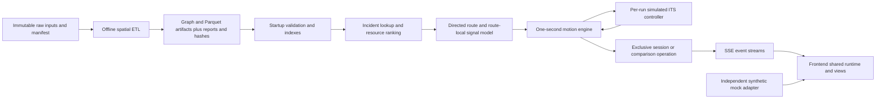
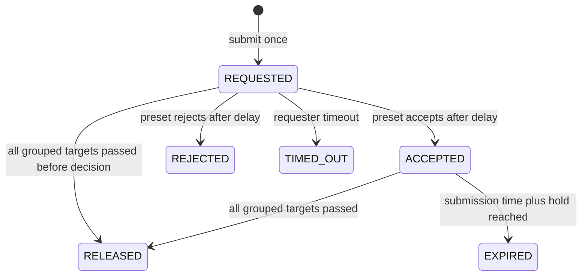
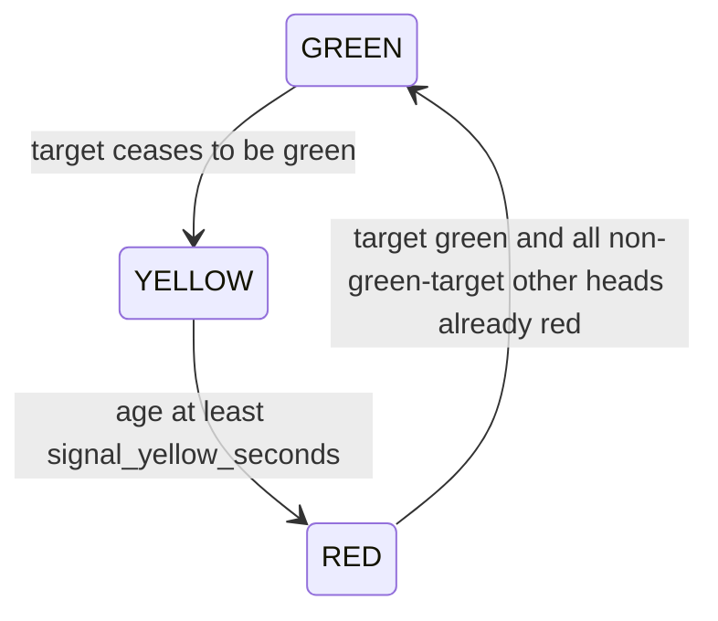

# Implemented application logic and mathematical audit

Audit date: 2026-10-30. Scope: the application at `origin/main` commit
`4eaaff1764d78e1453af944f026a68e6f1be05ef`, the base of `docs/app-logic-audit`. This is a source-derived description, not a proposed design or
calibration report. All signals, priority decisions, availability and travel predictions
are **simulated**. There is no physical signal actuation or live ITS connection.

## 1. Architecture and authority

Backend Pydantic models in [schemas](../../backend/src/greenwave/schemas/) define the
wire contract (`schema_version: "1.0"`, `is_simulated: true` on simulation responses/events).
[OpenAPI](../../contracts/openapi.json) and
[TypeScript API types](../../frontend/src/types/api.generated.ts) are generated from them.
Source links below identify the implementation behind each rule. Existing plans and the
architecture overview describe intent and history; discrepancies are listed in section 10.

### Ownership and boundaries

| Layer       | Responsibility and source                                                                                                                                                                                                                                                                                                                   |
| ----------- | ------------------------------------------------------------------------------------------------------------------------------------------------------------------------------------------------------------------------------------------------------------------------------------------------------------------------------------------- |
| Offline ETL | [etl](../../backend/src/greenwave/etl/): project coordinates, weld roads, build directed graph, attach attributes and stop lines, group intersections, build neighbour/places/resources/quality artifacts. Never runs inside the tick loop.                                                                                                 |
| Startup     | [main.py](../../backend/src/greenwave/main.py), [loader.py](../../backend/src/greenwave/dataset/loader.py): load once, validate manifest and cross-stage hashes, counts, references, positions, resources and quality summary; freeze graph and build indexes. Missing, stale or malformed data aborts startup. No automatic mock fallback. |
| Routing     | [planner.py](../../backend/src/greenwave/routing/planner.py), [network_index.py](../../backend/src/greenwave/routing/network_index.py): nearest eligible graph-node snapping, directed fastest ambulance route and stable parallel-edge selection.                                                                                          |
| Dispatch    | [station_ranking.py](../../backend/src/greenwave/routing/station_ranking.py), [team_ranking.py](../../backend/src/greenwave/routing/team_ranking.py): choose candidates before starting a simulation. Resource eligibility is scenario state, not live dispatch.                                                                            |
| Simulation  | [engine.py](../../backend/src/greenwave/simulation/engine.py), [motion.py](../../backend/src/greenwave/simulation/motion.py): motion, requests, feedback application, fallback and telemetry projection.                                                                                                                                    |
| ITS         | [controller.py](../../backend/src/greenwave/its/controller.py): sole runtime phase programme and request lifecycle. The optional legacy gateway is a diagnostic sink only and is not installed by the app.                                                                                                                                  |
| Transport   | [session.py](../../backend/src/greenwave/simulation/session.py), [api/simulation.py](../../backend/src/greenwave/api/simulation.py): exclusive operation, clock, cancellation, bounded queues and SSE. No WebSockets or durable event log.                                                                                                  |
| UI          | [simulation provider](../../frontend/src/components/simulation-provider.tsx), [controller](../../frontend/src/lib/simulation-controller.ts), [adapters](../../frontend/src/lib/simulation-adapter.ts): shared in-memory scenario and transport state across route navigation. Maps/HUD render the contract.                                 |

Artifact hashes detect inconsistent builds, not malicious tampering: `etl_report.json`
itself is not authenticated. The loader does not claim reproducible or trusted builds.

## 2. Modes, precedence and lifecycle

### Independent mode axes

| Axis              | Values                                                                    | Actual selection and effect                                                                                                                                                                           |
| ----------------- | ------------------------------------------------------------------------- | ----------------------------------------------------------------------------------------------------------------------------------------------------------------------------------------------------- |
| Transport         | `mock`, `backend`                                                         | Frontend build configuration, default `mock`. Backend failure does not switch transport. Mock is a separate synthetic implementation.                                                                 |
| Run mode          | `ENABLED`, `DISABLED`                                                     | Start request `green_wave_mode`, default `ENABLED`. Both use the same route selection and ambulance open-road speeds. Disabled uses ordinary stop-line crossing, never requests priority or cascades. |
| Junction crossing | `PRIORITY`, `STANDARD_FALLBACK`                                           | Enabled starts with `PRIORITY`; failed request targets still ahead become `STANDARD_FALLBACK` permanently for that run. Disabled reports `null`. This is not a third global run mode.                 |
| Controller preset | `NOMINAL`, `DELAYED`, `REJECTED`, `NO_FEEDBACK`, `MIXED`                  | Applies to enabled runs. Assembly forces `NOMINAL` for disabled runs, regardless of request.                                                                                                          |
| Cascade           | Boolean                                                                   | Effective only when enabled mode **and** `enable_cascade_mode` are true. Selection is one hop from independently eligible targets.                                                                    |
| Operation         | Single run or comparison pair                                             | One exclusive operation per server process. A comparison creates enabled and disabled members with the same scenario and one shared simulated clock.                                                  |
| Presentation      | Home, Green Wave, Standard traffic, Comparison, Diagnostics, Driver, Docs | [workspace-routes.ts](../../frontend/src/lib/workspace-routes.ts). Navigating views does not itself rewrite an active run's mode; a different mode requires replacement.                              |

Mode hierarchy: choose transport at build time; construct the request from UI settings;
apply run mode (disabled suppresses cascade and controller preset effects); process the
per-request outcome; apply fallback only to failed, unpassed junctions. The frontend
[start builder](../../frontend/src/lib/start-request.ts) also normalizes disabled scenarios
to `NOMINAL`. No automatic route replanning occurs on rejection or timeout.

### Server operation lifecycle

```mermaid
stateDiagram-v2
    [*] --> Idle
    Idle --> Planning: start or compare/start
    Running --> Planning: replacement request
    Planning --> Running: planning succeeds; supersede prior operation
    Planning --> Idle: plan fails and no prior operation
    Planning --> Running: plan fails; existing operation continues
    Running --> Recovering: vehicle arrives
    Recovering --> Completed: every junction NORMAL
    Running --> Cancelled: stop / supersede / loop error
    Recovering --> Cancelled: stop / supersede / loop error
    Completed --> Idle
    Cancelled --> Idle
```

This diagram summarizes operation ownership; planning executes in a worker thread while
an old operation can continue. A lock serializes start/stop planning. Active ID collision
returns HTTP 409 **before** replacement. Both comparison plans must succeed before the
old operation is superseded. Ended IDs may be reused and replace their retained entry.

Each loop immediately steps every unfinished member once, then sleeps the remaining
interval. Both members get the same wall-clock timestamp. Stopping either member stops
the pair; a completed member's existing terminal is preserved. A loop exception cancels
unfinished members with `SERVER_ERROR`. Explicit stop uses `STOPPED`; replacement uses
`SUPERSEDED`. Exactly one terminal is published per run. Failed ITS requests no longer
emit the compatibility cancellation reasons `ITS_REJECTED`, `ITS_TIMEOUT`, or
`ITS_HOLD_EXPIRED`.

Arrival is fractional simulated time; completion waits for signal recovery. KPI elapsed
time freezes at arrival. Further recovery ticks show speed zero and status `ARRIVED`.
A disconnect unsubscribes a client, not the run. Shutdown cancels active operations.

### Tick order and clocks

A [step](../../backend/src/greenwave/simulation/engine.py) performs, in order:

1. Move for one simulated second under the **previous** controller report.
2. Build complete observations (TTIs and passed flags) and advance the controller.
3. Apply valid controller feedback, then requester acknowledgement timeouts.
4. Mark failed request targets ahead as fallback.
5. If enabled, select and submit one grouped dispatch for this tick.
6. Emit feedback, optional dispatch, tick, then completion if arrived and all normal.

A newly submitted request cannot affect the movement or reported phase of that same step.
Fallback applied after movement affects the next motion step. Every step increments tick
and simulated time by **one**, even at accelerated playback. With playback factor $p$,
configured interval $I$ and step processing duration $c$, wall sleep is

$$\Delta t_{\rm sleep}=\max(0,I/p-c).$$

Missed deadlines log a warning; there is no burst of catch-up ticks. Changing $I$ changes
wall pacing, not the simulated second. Expected ITS arrival timestamps separately divide
TTI by $p$; they do not include a nondefault $I$ (see limitations).

## 3. Configuration reference

### Sources and override rules

[SimulationSettings](../../backend/src/greenwave/simulation_settings.py) is instantiated at
startup and frozen. For a field `x`, use environment variable `GREENWAVE_SIM_X` (uppercase).
Explicit constructor arguments override environment values, which override field defaults.
No dotenv file, secrets directory, CLI settings source or hot-reload endpoint is configured
by these classes. A launcher/Compose environment can supply variables, but the app does not
read a `.env` file itself. This follows the default
[Pydantic Settings source ordering](https://github.com/pydantic/pydantic-settings/blob/main/docs/index.md#field-value-priority).
Changing the process environment after startup does not update existing engines.

Run request parameters are a separate validated layer; they do not override arbitrary
`SimulationSettings` fields. Unknown request fields follow Pydantic's default ignore
behavior; these request models do not enable strict types or `extra="forbid"`.

| Configuration                      | Default                                                 | Validation / scope                                                                                                                |
| ---------------------------------- | ------------------------------------------------------- | --------------------------------------------------------------------------------------------------------------------------------- |
| `GREENWAVE_PROCESSED_DIR`          | `backend/data/processed` resolved from package location | `Path`; validated artifacts required at startup                                                                                   |
| `GREENWAVE_RAW_MANIFEST_PATH`      | `backend/data/raw/MANIFEST.json`                        | `Path`; manifest must agree with processed artifacts                                                                              |
| `GREENWAVE_CORS_ORIGINS`           | `http://localhost:3000`                                 | Comma split, trimmed, empty entries removed; no URL validator. Credentials false, GET/POST allowed. Read when app is constructed. |
| `NEXT_PUBLIC_SIMULATION_TRANSPORT` | `mock`                                                  | Trimmed `mock` or `backend`; invalid value warns and selects mock                                                                 |
| `NEXT_PUBLIC_API_BASE_URL`         | `http://127.0.0.1:8000`                                 | HTTP(S) URL only; retain origin/path, remove trailing slash, query/hash; invalid value warns and uses default                     |

`create_app(dataset=...)` bypasses disk loading for injected datasets; combining it with
path arguments raises `ValueError`. Explicit `processed_dir`/`manifest_path` arguments win
over dataset environment settings. Frontend public values are compiled into the bundle
and [cached](../../frontend/src/lib/config.ts) once per JS runtime. They are not server
simulation tuning variables. Client connection constants are 3 s stale, 15 s lost,
10,000 ms start timeout and 5 failed reconnect attempts; these have no environment override.

### Every simulation setting

Bounds below are exactly the declared field bounds, before cross-field validation.
`finite` means explicit `allow_inf_nan=False`; do not infer that constraint for other floats.
Units follow the names (`m`, `s`, `km/h`, `m/s`); factors and counts are dimensionless.

| Field (`GREENWAVE_SIM_` prefix)   | Default | Bounds         |
| --------------------------------- | ------- | -------------- |
| `clearing_tti_seconds`            | `40`    | ge 0           |
| `priority_green_tti_seconds`      | `25`    | ge 0           |
| `recovery_hold_seconds`           | `15`    | ge 0           |
| `min_intersection_delay_seconds`  | `3`     | ge 0           |
| `greenwave_approach_distance_m`   | `60`    | gt 0, finite   |
| `greenwave_min_rolling_speed_kmh` | `15`    | gt 0, finite   |
| `ambulance_speed_factor`          | `1.3`   | gt 0           |
| `ambulance_min_speed_kmh`         | `30`    | ge 0           |
| `ambulance_max_speed_kmh`         | `90`    | gt 0           |
| `speed_ema_alpha`                 | `0.25`  | gt 0, le 1     |
| `speed_floor_meters_per_second`   | `5`     | ge 0           |
| `its_ack_delay_seconds`           | `1`     | ge 1           |
| `its_delayed_ack_seconds`         | `5`     | ge 1           |
| `its_ack_timeout_seconds`         | `8`     | ge 2           |
| `its_min_hold_seconds`            | `40`    | ge 0           |
| `its_hold_buffer_seconds`         | `5`     | ge 0           |
| `tick_interval_seconds`           | `1`     | gt 0           |
| `max_snap_distance_meters`        | `150`   | ge 0           |
| `max_on_foot_meters`              | `800`   | gt 0, finite   |
| `on_foot_detour_factor`           | `1.3`   | ge 1.0, finite |
| `on_foot_speed_meters_per_second` | `1.4`   | gt 0, finite   |
| `dispatch_shortlist_size`         | `5`     | ge 1           |
| `area_preference_margin_seconds`  | `60`    | ge 0, finite   |
| `subscriber_queue_size`           | `32`    | ge 1           |
| `retained_session_limit`          | `4`     | ge 1           |
| `normal_single_lane_factor`       | `1.15`  | ge 1.0         |
| `normal_unpaved_factor`           | `1.3`   | ge 1.0         |
| `normal_calming_seconds`          | `3.0`   | ge 0           |
| `ambulance_calming_seconds`       | `2.0`   | ge 0           |
| `ambulance_bus_lane_factor`       | `1.05`  | ge 1.0         |
| `ambulance_tram_track_factor`     | `1.05`  | ge 1.0         |
| `signal_green_seconds`            | `30`    | gt 0           |
| `signal_yellow_seconds`           | `3`     | ge 0           |
| `signal_all_red_seconds`          | `2`     | ge 0           |
| `standard_clearance_factor`       | `1.0`   | ge 0, finite   |
| `standard_crossing_distance_m`    | `30`    | gt 0, finite   |
| `standard_min_rolling_speed_kmh`  | `10`    | gt 0, finite   |
| `standard_max_red_loss_seconds`   | `15`    | ge 0, finite   |

Cross-field validation additionally requires
`its_ack_delay_seconds <= its_delayed_ack_seconds < its_ack_timeout_seconds`,
`priority_green_tti_seconds <= clearing_tti_seconds`, and
`ambulance_min_speed_kmh <= ambulance_max_speed_kmh`.

### Request options and frontend defaults

Canonical sources: [simulation schema](../../backend/src/greenwave/schemas/simulation.py),
[ITS schema](../../backend/src/greenwave/schemas/its.py),
[dispatch schema](../../backend/src/greenwave/schemas/dispatch.py),
[start builder](../../frontend/src/lib/start-request.ts).

| Field                        | API default / requirement                             | UI initial value / semantics                                                                               |
| ---------------------------- | ----------------------------------------------------- | ---------------------------------------------------------------------------------------------------------- |
| `simulation_id`              | Required; `^[A-Za-z0-9_-]{1,64}$` pattern             | Client chosen; active collision is 409                                                                     |
| `origin`, `destination`      | Required; lat in [-90,90], lng in [-180,180]          | Chosen station and incident, respectively                                                                  |
| `traffic_density_multiplier` | Required for start, [1,3]; ranking default 1          | 1.5; changes ordinary-car estimate and standard red loss, not open-road ambulance speed                    |
| `enable_cascade_mode`        | Required boolean                                      | true; ignored by disabled mode                                                                             |
| `playback_speed`             | Integer [1,10], default 1                             | 1; controls wall pacing only                                                                               |
| `vehicle_type`               | `AMBULANCE` default; also `FIRE_TRUCK`, `POLICE_CAR`  | Chooses stations and presentation; all share the ambulance speed model                                     |
| `green_wave_mode`            | `ENABLED` default; also `DISABLED`                    | Mode-specific view/settings; comparison creates one of each                                                |
| `its_scenario`               | `NOMINAL` default; five closed enum values            | `NOMINAL`; disabled forces nominal                                                                         |
| `its_outcome_seed`           | Integer [0, 4294967295], default 0                    | 0; UI truncates finite numbers, clamps to range, non-finite/undefined becomes 0; fixed presets ignore seed |
| Comparison IDs               | Required enabled/disabled IDs, must differ            | Each streams/stops at its own URL; no global mode field in comparison request                              |
| Rank `time_mode`             | `ENABLED` default                                     | Selects drive estimate used for ranking, including area rule                                               |
| Rank `resource_aware`        | false                                                 | Opt-in ambulance team eligibility/area policy; false ranks bases by time                                   |
| Rank `scenario_time`         | null → server's Warsaw time, minute precision         | Aware inputs convert to Europe/Warsaw, naive inputs interpreted as local; not a signal-cycle offset        |
| Rank `availability`          | Empty dict; at most 200 team-code keys; `free`/`busy` | Missing means assumed free if on shift; free cannot override off shift                                     |
| Geocode `q`, `limit`         | Query length 2–100; limit 1–10, default 8             | Local address search, no external geocoder                                                                 |

### Controller response presets and deterministic draws

| Preset        | Result for each grouped request                                               | Default simulated delay |
| ------------- | ----------------------------------------------------------------------------- | ----------------------- |
| `NOMINAL`     | `ACCEPTED`                                                                    | 1 s                     |
| `DELAYED`     | `ACCEPTED`                                                                    | 5 s                     |
| `REJECTED`    | `REJECTED`, reason `CONTROLLER_REJECTED`                                      | 1 s                     |
| `NO_FEEDBACK` | No controller response; requester marks `TIMED_OUT` / `ACK_TIMEOUT`           | 8 s timeout             |
| `MIXED`       | One of the above four outcomes, deterministic from seed and sorted target IDs | Outcome-specific        |

[MIXED](../../backend/src/greenwave/its/controller.py) is a reproducible hash partition,
not independent random sampling per junction or per tick. A grouped request shares one
outcome. Serialize UTF-8 `"<seed>:<comma-joined sorted IDs>"`; compute FNV-1a using
$h_0=\mathtt{0x811C9DC5}$ and, for each byte $b$,

$$h\leftarrow((h\oplus b)\,\mathtt{0x01000193})\bmod 2^{32}.$$

Finalize using MurmurHash3 `fmix32`:

$$
\begin{aligned}
h&\leftarrow h\oplus(h\gg16),\\
h&\leftarrow h\,\mathtt{0x85EBCA6B}\bmod2^{32},\\
h&\leftarrow h\oplus(h\gg13),\\
h&\leftarrow h\,\mathtt{0xC2B2AE35}\bmod2^{32},\\
h&\leftarrow h\oplus(h\gg16).
\end{aligned}
$$

Index $h\gg30$ selects `ACCEPT`, `ACCEPT_DELAYED`, `REJECT`, `NO_RESPONSE` in that order.
The four hash buckets each occupy one quarter of the 32-bit output space; this is not
a guarantee of 25% observed frequency on a finite seed/route set. Time, playback and
simulation ID are not hash inputs; cascade changes grouping and can change the outcome.

### Offline ETL settings

[etl/config.py](../../backend/src/greenwave/etl/config.py) holds Python constants,
not request/runtime environment overrides. Changes to derived artifact inputs require
regenerating the affected stages. A few constants also have runtime consumers:
`AREA_LOOKUP_RADIUS_M` controls incident-area lookup and `ADDRESS_MATCH_CLEAN_M` controls
address disagreement presentation. Changing those consumers requires restarting the server;
rebuild any artifacts that also depend on the changed constant.
Its comments mark approved rules, analysis-only probes and uncalibrated placeholders.
The full constant inventory is in [section 11](#11-offline-configuration-inventory).
Important model inputs are:

| Rule                                  | Implemented default                                                                                                                   |
| ------------------------------------- | ------------------------------------------------------------------------------------------------------------------------------------- |
| CRS                                   | Source EPSG:4326; metric calculations EPSG:2178                                                                                       |
| Ordinary intersection delays          | Signalised junction, mid-block signal and pedestrian crossing each 35 s; counted once per unique intersection, not per signal         |
| Cascade threshold                     | 250 m inclusive; loaded from processed neighbours report into routing index                                                           |
| Signal grouping / standalone crossing | 40 m single linkage; crossing within 30 m of counted signal is duplicate                                                              |
| Junction assignment and merging       | ≥3 distinct neighbours; 50 m approach assignment; 30 m junction merge; 15 m pedestrian crossing merge; 65 m merged-group diameter cap |
| Road welding                          | 1 m, respecting layer/bridge/tunnel separation                                                                                        |
| Tram track matching                   | Within 6 m along at least 0.5 of edge length                                                                                          |
| Places / address matching             | Station dedup 150 m; address dedup 400 m; EMUiA clean agreement ≤100 m and maximum pair match ≤500 m; name-variant 50 m / tight 20 m  |
| Dispatch geography                    | PRM/OSM base match 200 m; nearest EMUiA district lookup 250 m; places snap default 150 m                                              |

[Road rules](../../backend/src/greenwave/etl/road_rules.py) accept positive integer
`maxspeed` with optional `km/h`; values such as `50 mph`, `PL:urban`, `none`, lists or
zero use the road-class default with an explicit source marker. Defaults: motorway 140,
trunk 70, residential 30, living_street 20, service 30, track 15, pedestrian 10, other supported
classes 50 km/h. Explicit one-way tags win, including `oneway=no`; otherwise roundabout /
circular and motorway / motorway_link imply forward one-way; others default two-way.
Unrecognized direction tags raise an error rather than silently choosing a direction.

## 4. Routing, spatial math and resource selection

### Distance and path cost

Lengths and snapping use projected metres. The snap set is the largest strongly connected
component, so snapped nodes mutually connect in the loaded graph. The graph retains other
components, but they are excluded from endpoint snapping.
Origin beyond the 150 m snap bound raises `ORIGIN_OFF_NETWORK`. Destination outside the
bound attempts on-foot access; an in-bound but unreachable destination does not trigger
that fallback (normally snapped nodes share the largest strongly connected component,
so this unreachable case concerns nonstandard/injected indexes). Same-node direct simulation raises `NO_ROUTE`; dispatch can instead answer
on site without starting a run.

The [path weight](../../backend/src/greenwave/routing/planner.py) is ambulance **edge**
travel time, including calming but excluding junction penalties, density, controller
outcomes and signal timing. For parallel edges use the smallest edge time; selection ties
use edge ID. Both modes therefore select the same route. Dijkstra-style graph searches
have usual $O((|V|+|E|)\log|V|)$ heap complexity. They run during planning/ranking, outside
the event loop's motion step.

Each controlled edge ends at a route stop line. Group those lines by unique intersection
ID, preserving its first/last positions and all distinct intermediate lines. The nominal
estimate charges its delay once; Standard motion can make a decision at **every** line.

### Off-road access

For projected straight-line distance $r_n$ from node $n$ to incident, detour factor $f=1.3$
and walking speed $u=1.4$ m/s:

$$d_{\rm walk}(n)=f r_n,\qquad T_{\rm walk}(n)=fr_n/u.$$

Consider eligible nodes with $fr_n\le800$ m and select the reachable node minimizing
$T_{\rm drive,edge}(n)+T_{\rm walk}(n)$, ties by node key. The origin node is excluded
from driven access selection. No candidate within reach gives `DESTINATION_OFF_NETWORK`;
no reachable candidate gives `NO_ROUTE`. The walk is a barrier-free straight-line model
with a scalar detour, not pedestrian routing. Run estimates/KPIs end at vehicle arrival;
`destination_on_foot` reports the walk separately.

### Ranking and area policy

Station ranking runs reversed Dijkstra from the incident (or multiple access nodes seeded
with walking time), then fully estimates the best five reachable bases by default. Sort
by mode-specific drive + walk, tie by station ID; return up to three. A base on the
incident node is on site. For off-network incidents, walk directly from the station when
it beats driving to another access point; driving wins equal totals. The top-five cut can
omit a base that would win after junction timing is included.

Resource-aware ambulance ranking evaluates **all eligible bases** (overriding that cut),
selecting one team per base: in-area first, then team code. Eligibility requires matching
weekday (Monday 1), inclusive `MM-DD` season (including year-wrapping seasons), and
minute-of-day in `[ready_from_min, ready_to_min)`. Off shift wins over any override; on-shift
`busy` is excluded; missing override is eligible but badged `assumed_free`. No eligible
team returns `NO_ELIGIBLE_RESOURCE`, not a fabricated vehicle. Eligible teams with no
reachable base return `NO_STATION_REACHABLE`.

Let $T_*$ be the fastest candidate's total and $T_A$ the fastest in-area total. If an
in-area candidate exists and

$$T_A-T_*\le \texttt{area_preference_margin_seconds}=60\text{ s},$$

choose it; otherwise choose the fastest. If fastest is already in-area (or no in-area
candidate), reason is `NEAREST`; otherwise `IN_AREA_WITHIN_MARGIN` or
`NEAREST_OUTSIDE_MARGIN`. Put recommendation first, remaining candidates by total.
Unknown incident area gives pure nearest ranking. Team type is display metadata, not
a ranking coefficient. Fire/police and `resource_aware=false` bypass team policy.

### Address and incident lookup

[Address search](../../backend/src/greenwave/places/address_index.py) normalizes street
keys, then orders prefix matches before substring matches, exact trailing house number
before number prefixes, Kraków before outside addresses, street and natural house number,
distance to city centre, latitude and longitude. Alternate street names index the same
record; duplicate labels collapse to the best hit. EMUiA coordinates take precedence for
matched addresses; OSM displacement above 100 m is surfaced as disagreement.
[Incident area](../../backend/src/greenwave/places/incident_area.py) uses the nearest
EMUiA-backed district point within 250 m and maps districts 1–3 to Śródmieście, 4–7 to
Krowodrza, 8–13 to Podgórze and 14–18 to Nowa Huta. There is no polygon containment
check in this lookup; a nearby point supplies the district.

## 5. Travel-time formulas, motion and KPIs

### Edge models and three different trip times

Source: [edge_times.py](../../backend/src/greenwave/routing/edge_times.py),
[estimates.py](../../backend/src/greenwave/routing/estimates.py).
Let $L_e$ be edge metres, $V_e$ its ordinary km/h, $n_e$ calming feature count,
$\mu$ traffic density, $D_i$ the stored ordinary delay, and $N$ unique route intersections.
The maximum applicable boost is used, **not** a product:

$$b_e=\max(1,\ b_{\rm bus}\text{ if bus lane},\ b_{\rm tram}\text{ if tram track}).$$

$$V_{a,e}=\min\{\max(f_a V_e b_e,V_{a,\min}),V_{a,\max}\}.$$

Defaults are $f_a=1.3$, $V_{a,\min}=30$, $V_{a,\max}=90$ km/h and both boosts 1.05.
Lane factor $\ell_e=1.15$ exactly when `lanes_per_direction == 1`, else 1;
surface factor $s_e=1.3$ exactly when `surface_class == "unpaved"`, else 1.
Unknown attributes are neutral. Then

$$ \begin{aligned}
t_{a,e}&=L_e/(V_{a,e}/3.6)+n_e c_a, & c_a&=2\text{ s},\\
t_{n,e}&=L_e\mu\ell_es_e/(V_e/3.6)+n_e c_n, & c_n&=3\text{ s},\\
\widehat T_{\rm normal}&=\sum_e t_{n,e}+\sum_iD_i,\\
\widehat T_{\rm greenwave}&=\sum_e t_{a,e}+N D_{\min}, &D_{\min}&=3\text{ s}.
\end{aligned}$$

`estimated_normal_time_sec` is an ordinary-car **formula**, not the time of the disabled
ambulance. `estimated_greenwave_time_sec` is nominal and does not simulate acknowledgement,
signal holds, rejection or fallback. `estimated_standard_time_sec` is an actual dry run of
the disabled ambulance's motion from time zero (section 5 below). All three cover the
already chosen route; they are not three independently optimized routes.

### One-second integrator

[RouteTrack](../../backend/src/greenwave/simulation/route_track.py) spreads calming
penalties uniformly over an edge: effective speed $u_e=L_e/t_{a,e}$ for positive length;
zero-length edges use boosted speed directly. Each step spends a one-second budget,
splitting at edge boundaries, approach starts, stop lines, crossing ends and destination.
For remaining time $B$ and distance $d$ to the next boundary, move
$\min(d,uB)$, deduct actual travel time, and continue on the next segment. Fractional
arrival is recorded as $t_{\rm old}+1-B_{\rm remaining}$; telemetry speed is distance
actually driven in that second times 3.6, not the instantaneous final-edge speed.
Tolerances are $10^{-9}$ s/m in the integrator.

### Enabled rolling slowdown and safety hold

For a junction's first line at $s_i$, approach starts at

$$a_i=\max(s_{\rm previous\ first\ line},\ s_i-60\text{ m}),$$

with previous position zero when absent. At actual slowdown start $x$, let $W=s_i-x$,
$u$ current ambulance m/s, $u_f=15/3.6$ m/s. For $u>u_f$, set

$$C=\max\left(W,\frac{D_{\min}}{1/u_f-1/u}\right);$$

otherwise use $C=W$. Add $C$ to any still-running crossing distance (capped at distance
to destination), and $D_{\min}$ to remaining extra time $E$. Spend it with the shared
cautious-speed formula

$$u_c=\frac{1}{1/u+E/R},\qquad
E' = E(1-\Delta x/R),\quad R'=R-\Delta x,$$

where $R$ is remaining crossing distance. At constant $u$, driving $R$ takes $R/u+E$;
this explains how a delay is spent while rolling. Adjacent slowdowns can merge. With no
room to roll, the code uses a dwell of $D_{\min}$ instead. For a route-ending truncation
or combined slowdown the floor is not mathematically guaranteed (section 10).

At the priority first line the vehicle holds until all **known supported route vehicle
indications** at that stop-line ownership set were green in the previous report. A known
red/yellow blocks departure even if acceptance has occurred. With no supported route
vehicle phases the check permits departure; it does not fabricate confirmed green.
Later internal lines of the same priority junction do not start another slowdown/hold;
they remain relevant to phase grouping and last-line release. Fallback targets are excluded
from this hold. A hold already waiting there is released
through Standard crossing rules once its owner has fallen back.

### Standard and fallback crossing

Disabled mode applies this at every route stop line; enabled mode applies it only to
fallback owners. Sample the ordinary programme at the **fractional** line-arrival time.
All facing route movements green means drive on. Red/yellow/unknown starts a controlled
rolling crossing. With multiple owners, use the longest wait among non-green owners.
If a supported movement has no next-green answer, use its $D_i$.

For slot length $S=G+Y+A$, cycle $C_y=2S$, route slot $g$, define
$q=(t-gS)\bmod C_y$. The wait is

$$w(t)=\begin{cases}0&q<G,\\C_y-q&q\ge G.\end{cases}$$

For ordinary crossing speed limit $u=\min(u_e,V_e/3.6)$, floor $u_f=10/3.6$, factor
$k=1$, maximum red loss $E_{\max}=15$ s and minimum length $L_c=30$ m:

$$\begin{aligned}
E&=\min(k\mu w,E_{\max}),\\
R&=\max\left(L_c,\frac{E}{1/u_f-1/u}\right)\quad(u>u_f).
\end{aligned}$$

If $u\le u_f$, use $R=L_c$, $E=0$. Unknown movement substitutes $D_i$ for $w$.
Sizing examines covered edges and lowers $u$ to the slowest ordinary limit, lengthening
the crossing until consistent. If a later edge is at/below the floor, end at its start
and cap extra time to fit preceding distance. Motion uses $u_c$ above, with each covered
edge's ordinary limit; open road still uses ambulance speed. There is no stop-and-wait
until green in this model. The ordinary-car lane/surface penalties do not enter it.

A later line replaces an ongoing Standard crossing; green can clear its remainder.
Fallback also replaces its own earlier priority slowdown remainder, avoiding two penalties
for that owner. A previous priority junction's remaining slowdown is retained/merged.
The crossing extra time is bounded per decision, not per unique junction or complete route.
A destination reached before crossing end discards its unspent remainder.

### Standard profile, savings and rounding

[standard_estimate.py](../../backend/src/greenwave/simulation/standard_estimate.py)
dry-runs the **same** `move_one_second` in disabled mode using ordinary controller queries.
It records $(x_k,t_k)$ each second plus the exact final fractional arrival. The finite
iteration bound is the sum of every edge traversed at its ordinary limit plus
`stop_line_count * standard_max_red_loss_seconds`, rounded up plus one step; an
undriveable/non-arriving route raises `RuntimeError`.

For position $x$ between profile samples, linear interpolation gives

$$T_s(x)=t_l+\frac{x-x_l}{x_r-x_l}(t_r-t_l).$$

The final estimate is exact with respect to this integrator; time at intermediate
positions is interpolated across a one-second sample and can straddle speed changes.
[Live KPIs](../../backend/src/greenwave/simulation/telemetry.py) use

$$T_{\rm elapsed}=\begin{cases}t_{\rm arrival}&\text{arrived},\\t&\text{otherwise},\end{cases}$$

$$\texttt{current_time_saved_sec}=\begin{cases}
0&\text{disabled},\\
\operatorname{round}(T_s(x))-\operatorname{round}(T_{\rm elapsed})&\text{enabled}.
\end{cases}$$

Elapsed KPI is $\operatorname{round}(T_{\rm elapsed})$. The difference is of **separately
rounded** times, not a rounded difference, and is not clamped to zero. Enabled can be
slower. Python `round` uses ties-to-even. Start response estimates are also rounded.
Recovery ticks do not erode savings. Displayed TTI is rounded; request eligibility uses
the unrounded value.

The [comparison result](../../frontend/src/lib/comparison/race.ts) requires both successful
completion payloads and subtracts their reported arrival times:
$\Delta=T_{\rm disabled}-T_{\rm enabled}$. Its live distance lead is enabled minus disabled
distance, called level when absolute lead is **less than** 10 m. It can show physical
arrival before terminal recovery completes; a tie chooses enabled for its arrival label.

### Geometry used for display

Route metric distance is not recomputed from screen coordinates. `RouteTrack.position_at`
uses equirectangular WGS84 polyline segment lengths

$$\delta_j=111320\sqrt{(\Delta\lambda_j\cos\varphi_0)^2+(\Delta\varphi_j)^2},$$

where longitude/latitude differences are in degrees and $\varphi_0$ is converted to radians
for cosine. Map $x/L_{\rm route}$ to the same fraction of total polyline offsets and
linearly interpolate longitude/latitude in that segment. This tolerates metric/display
length differences; it is a city-scale rendering approximation, not the routing metric.

## 6. Priority selection, cascade and request lifecycle

### TTI and cascade

[TTI](../../backend/src/greenwave/simulation/corridor.py) uses first line $s_i$ and distance
travelled $x$, with a moving speed estimate:

$$\bar v_t=\max\{v_{\rm floor},\alpha\Delta x_t+(1-\alpha)\bar v_{t-1}\},\quad
\mathrm{TTI}_i=\frac{\max(0,s_i-x)}{\bar v_t}.$$

Defaults are $\alpha=0.25$, $v_{\rm floor}=5$ m/s; initial EMA is maximum of first-edge
effective speed and that floor. Since the step is one second, $\Delta x_t$ numerically
has units m/s. Passed junctions have TTI `null`. A zero configured floor permits division
by zero in a later stopped state; the schema allows it but supplies no separate guard.

[Selection](../../backend/src/greenwave/simulation/priority_requests.py) takes every
unrequested, unpassed target with TTI ≤40 s. Add each such source's forward cascade
targets, not the targets' targets. [Route model](../../backend/src/greenwave/simulation/route_model.py)
uses **first-to-first along-route distance ≤ the loaded threshold** (default 250 m).
The offline shortest-drive neighbour table is diagnostic/candidate evidence, not a
runtime membership gate. Sources are marked `is_cascade=false`; added targets that are
not independently eligible are true. At most one grouped request per tick; each target
is requested at most once, including after failure. Separate requests never compete for
a previously used target.

### Hold and expected arrival

For each selected target $i$, [release time](../../backend/src/greenwave/simulation/dispatch.py)
is estimated as

$$R_i=T_{\rm open}(x,s_{i,\rm last})+D_{\min}J_i+E_{\rm remaining},$$

where $J_i$ counts unpassed junctions with first line ≤ target first line **or** first line
strictly inside its last line. The in-progress slowdown can be counted both in $J_i$ and
$E_{\rm remaining}$; this conservatively lengthens the hold. It does not predict future
unconfirmed-green waits or Standard fallback loss.

$$H=\max(\texttt{its_min_hold_seconds},\lceil\max_iR_i\rceil+\texttt{its_hold_buffer_seconds}),$$

$$\mathrm{expected\ arrival\ UTC}=\mathrm{now\ UTC}+\min_i\mathrm{TTI}_i/p.$$

Default minimum/buffer are 40/5 s. The payload separately validates $H\ge40$ even if the
setting is configured lower. Hold expiry is measured from **submission**, not acceptance.

### Request transitions

The controller first checks all-targets-passed release, then due acknowledgement, then
accepted hold expiry. Acceptance after the hold deadline immediately produces acceptance
and expiry together and never activates an expired target. `NO_RESPONSE` stays pending
until timeout unless all targets pass first. Timeout withdraws it and reserves a controller
sequence number, preventing a later decision/activation. Rejection, timeout and expiry
put only their **unpassed** targets into permanent fallback. Other targets keep requesting
priority; the enabled run can complete with `fallback_intersection_ids` in route order.

The ledger accepts feedback only for its simulation and known request, with exactly
matching ordered target group, strictly increasing global feedback sequence, legal
transition and nondecreasing observed simulated time. Wrong-run, duplicate, stale and
out-of-order feedback is ignored. Identical duplicate submission is idempotent;
conflicting duplicates or unknown/reused controller targets raise an error. Closing a
controller clears its requests and blocks further activation.

## 7. Intersection state machine

The authoritative [controller](../../backend/src/greenwave/its/controller.py) computes
state from observations and accepted requests; it is not a chain of unconditional TTI
threshold transitions. Runtime defaults are `NORMAL`, `is_cascade=false`, unpassed.

```mermaid
stateDiagram-v2
    [*] --> NORMAL
    NORMAL --> CLEARING: accepted request; waiting for eligibility or shown green
    NORMAL --> PRIORITY_GREEN: accepted; TTI at most 25; route indications already green
    CLEARING --> PRIORITY_GREEN: TTI at most 25 and all route vehicle indications green
    PRIORITY_GREEN --> CLEARING: TTI above priority threshold or no shown-green confirmation
    CLEARING --> NORMAL: request no longer accepted and target unpassed
    PRIORITY_GREEN --> NORMAL: request no longer accepted and target unpassed
    CLEARING --> RECOVERY: passed after active priority state
    PRIORITY_GREEN --> RECOVERY: passed after active priority state
    RECOVERY --> NORMAL: recovery age at least 15 s
    NORMAL --> NORMAL: passed without active priority
```

| State | Exact condition / consequence |
| --- | --- |
| `NORMAL` | No accepted priority for an unpassed target, or passed without previous active state, or recovery completed. A pending dispatch alone stays normal. Ordinary programme applies. |
| `CLEARING` | Accepted, unpassed, TTI >25 s or no TTI; also the reported downgrade when priority targets cannot be confirmed all green. Non-route vehicles and pedestrians target red; route vehicles keep ordinary colour while the programme is in clearing. |
| `PRIORITY_GREEN` | Accepted, unpassed, TTI ≤25 s, and every supported route vehicle indication is present and shown green. Programme targets route vehicles green, others red. No route vehicle phases means reported clearing, never confirmed priority green. |
| `RECOVERY` | A previously active target becomes passed. Records recovery start time and preserves cascade flag. Ordinary cycle resumes immediately; 15 s is a runtime recovery hold, not an additional all-red phase. |

The controller creates programme targets from tentative runtimes **before** downgrading
unconfirmed `PRIORITY_GREEN` to reported `CLEARING`. This lets clearance advance toward
priority even while the reported state remains clearing. A target can enter priority
directly from normal if acceptance, eligibility and green confirmation coincide.
TTI eligibility is recomputed each tick; there is no latch that requires priority to
remain green after TTI increases.

Passed requires reaching the **last** line and no longer holding there. An active last
line remains protected through the tick whose movement carries the vehicle across it:
`holding_priority` compares that line with both pre-step and post-step distance. Shared
line waits count for every owning junction. At a destination on that line the arrival
interval remains protected, then recovery can begin next tick. A request passed while
never active needs no recovery. Cancellation closes the controller; it does not stream
15 extra recovery seconds or send a physical reset.

`is_active_corridor` is true exactly in clearing/priority-green. `is_cascade` is separate
metadata, never a state named `CLEARING_CASCADE`. The frontend consumes these fields;
it does not infer accepted green from an ITS dispatch.

## 8. Ordinary and priority signal programmes

Source: [phases.py](../../backend/src/greenwave/simulation/phases.py).
This is a two-slot explanatory abstraction, not geometry-derived lane conflict planning.
A movement group is the sorted controlled-edge identity. All route signal groups are
merged into one through-movement group; pedestrian-only nodes crossing those arms share
its slot. Sort group identities and assign ordinal modulo two. A signal without
controlled-edge identity has no slot/indicator. A vehicle-capable route signal is one
whose controlled edges intersect the route's approach edges. Missing geometry produces
no indicator, rather than a synthetic backend position.

### Ordinary schedule

Let green $G=30$ s, yellow $Y=3$ s, all-red $A=2$ s. Slot $S=G+Y+A=35$ s;
cycle $C_y=2S=70$ s. For absolute simulated time $t$:

$$p=t\bmod C_y,\quad g_{\rm active}=\lfloor p/S\rfloor,\quad r=p-g_{\rm active}S.$$

| Within-slot time | Active slot vehicles | Other slot vehicles | Pedestrians crossing other slot's arm |
| --- | --- | --- | --- |
| $0\le r<G$ | GREEN | RED | GREEN, if shown vehicles of that arm are all red |
| $G\le r<G+Y$ | YELLOW | RED | RED |
| $G+Y\le r<S$ | RED | RED | RED |

Pedestrians on the active arm remain red. Traffic-signal nodes support vehicle and
pedestrian indications; crossing-only nodes support pedestrians only. Ordinary route
movement queries select the most restrictive supported vehicle colour (RED before
YELLOW before GREEN); absent route movement returns `None`. Normal and recovery use
the same absolute cycle, with no reset at release. Scenario date/time does not offset it.

### Priority targets and displayed clearance

Clearing targets all non-route vehicles and all pedestrians red. Route vehicles keep
ordinary programme colour. Priority-green targets route vehicles green, every other
vehicle and all pedestrians red.

Displayed vehicle heads obey this additional state machine:

A new head with no prior state initializes directly to its target. A yellow head must
finish yellow even if its target becomes green again. A red head only enters green when
all *other* prior heads not also targeting green are red. Thus the one-second projection
can add an extra tick after yellow turns red before another head enters green. This
check does **not** independently enforce `signal_all_red_seconds` during an arbitrary
priority switch; that configured interval belongs to the ordinary cycle. Even zero
yellow duration still takes a subsequent update to leave a newly entered yellow.
Pedestrians are suppressed to red while any shown vehicle on their arm remains green
or yellow; they have no yellow transition of their own.

Ordinary Standard/fallback motion samples the unsmoothed programme at fractional arrival,
not the tick-projected head. Enabled priority departure additionally checks the previous
**shown** phases. This distinction explains a map indication lag without changing the
ordinary crossing schedule. At high zoom the map renders vehicle indicators; pedestrian
payload detail remains available in diagnostics.

## 9. Frontend mock, stream handling and presentation math

### Synthetic mock differences

Sources: [mock-route-metrics.ts](../../frontend/src/lib/mock-route-metrics.ts),
[mock config](../../frontend/src/lib/mock-simulation-config.ts),
[mock-session.ts](../../frontend/src/lib/mock-session.ts),
[mock controller](../../frontend/src/lib/mock-its-controller.ts).

The mock is not an ETL dataset fallback and does not perform road-graph routing or snapping.
It draws a straight origin/destination route. With radian differences and radius
$R_E=6,371,000$ m:

$$h=\sin^2(\Delta\varphi/2)+\cos\varphi_1\cos\varphi_2\sin^2(\Delta\lambda/2),\quad
L=2R_E\arcsin\sqrt h.$$

Scale $q=L/5400$ gives $\widehat T_n=q\,780\,\mu/1.5$ and
$\widehat T_g=q\,380$. Synthetic intersections `INT-9001/9002` occur at fractions
$1480/5400$ and $1632/5400$ of the route, with forward cascade at ≤250 m. Snapped endpoints
are the request coordinates with zero snap distance. These are not Kraków road predictions.

Mock per-junction slowdown is $D=\min(3,\widehat T_g/(2N))$, preserving positive open-road
time for short synthetic routes; constant ambulance speed is $L/(\widehat T_g-ND)$.
Ordinary limit is at most 50 km/h. Standard red loss uses fixed **35 s** as the wait,
capped at 15 s after multiplying density; backend uses actual seconds until ordinary
green. Mock phases fix route S1 to slot 0 and conflicting S2 to slot 1, rather than deriving
movement groups from a dataset. Mock TTI uses remaining synthetic timeline time, rather
than backend EMA distance/speed. It uses the same hash/outcome order and default response
delays 1/5/8 s. Hold is $\max(40,\lceil\max\mathrm{TTI}\rceil+5)$, rather than the backend's
last-line release calculation. These frontend constants do not read backend environment
settings. JavaScript `Math.round` also differs from Python ties-to-even on half values.

The mock precomputes a disabled timeline for its Standard estimate/savings. It holds enabled
motion against previously shown route green, then applies controller feedback. Fallback
rebuilds only the undriven timeline from a cursor, retaining already-driven history;
ordinary-colour evaluation accounts for time lost in holds. Held time counts toward trip
time, recovery does not. Completion waits for route progress one and all signals normal.
These are contract-level parallels, not bit-for-bit parity with backend city simulation.

### Transport and client state

[SSE framing](../../backend/src/greenwave/api/sse.py) starts with `retry: 2000`, then
`event: <event_type>`, `id: <tick>`, `data: <JSON>`, blank line. Dispatch, feedback and tick
can share a tick ID. The stream is a snapshot plus live events, **not** replay from
`Last-Event-ID`. Retained terminal sessions yield latest nonterminal and terminal then close.
A bounded subscriber queue (default 32) drops its oldest event on overflow; feedback and
dispatch can be dropped too. Terminal delivery displaces a nonterminal and closes the stream.
Tick request snapshots allow pending/status reconstruction after missing individual events.
Retained-session limit (default four) counts sessions, not operations; active pair members
are preserved even if the configured limit is lower than the active operation size.

[Client reducer](../../frontend/src/lib/simulation-state.ts) phases are
`SETUP → STARTING → RUNNING → FINISHED/CANCELLED/ERROR`; reset returns to setup. Actions
are scoped to the current simulation ID; stale ticks/feedback are filtered using tick and
feedback sequence. Stop remains running until confirmed, with a separate stop error on
failure. Connection states are separate from simulation/ITS status. There is no automatic
controller-failure retry or automatic transport replacement.

[Backend adapter](../../frontend/src/lib/transport/backend-simulation-adapter.ts) validates
incoming JSON independently of generated TS types. Browser EventSource retries transient
connections; its permanently closed state is treated as `SIMULATION_NOT_FOUND`. Since
EventSource exposes no HTTP status, CORS/proxy errors can be misclassified this way. A
start timeout triggers best-effort stop, but a stop arriving before server registration
can return 404 and leave the late-started operation running until replacement/stop.

## 10. Architectural and mathematical findings

The following are source-derived limitations or documentation discrepancies, not runtime
changes made by this audit. Severity describes impact on this simulation, not real-world
signal safety. No calibrated performance or deployment-safety claim follows from the model.

| Priority | Finding and implementation evidence | Consequence / follow-up |
| --- | --- | --- |
| High | Nominal GreenWave estimate excludes controller holds and fallback; normal estimate is an ordinary car formula ([estimates](../../backend/src/greenwave/routing/estimates.py), [engine](../../backend/src/greenwave/simulation/engine.py)). | Do not present nominal difference as measured priority savings. Use actual Standard baseline/KPIs or completed pair. Calibrate separately. |
| High | Two-slot modulo grouping is not a lane conflict graph; Standard motion deliberately rolls red/yellow with capped delay ([phases](../../backend/src/greenwave/simulation/phases.py), [motion](../../backend/src/greenwave/simulation/motion.py)). | This is an explanatory emergency-response model, unsuitable as an operational controller or ordinary driver model. |
| Medium | `speed_floor_meters_per_second` allows zero, but TTI divides by the current EMA without a zero guard ([corridor](../../backend/src/greenwave/simulation/corridor.py)). With `speed_ema_alpha=1` and a full held tick, EMA becomes exactly zero; the subsequent TTI calculation divides by zero. | Defaults avoid this; validate positivity or explicitly define zero-speed TTI before supporting such configuration. |
| Medium | `its_min_hold_seconds` permits below 40 and low buffer, but dispatch payload requires ≥40 ([settings](../../backend/src/greenwave/simulation_settings.py), [dispatch](../../backend/src/greenwave/simulation/dispatch.py), [schema](../../backend/src/greenwave/schemas/simulation.py)). | Some individually valid configurations fail at dispatch and cancel the loop with `SERVER_ERROR`; align settings and payload validation in a future behavior change. |
| Medium | Several float fields lack explicit finite checks; no cross-field constraint guarantees a positive effective ambulance speed or floor compatibility ([settings](../../backend/src/greenwave/simulation_settings.py)). | Extreme configuration can invalidate timing assumptions; current validators are the documented bounds, not a proof of model validity. |
| Medium | Enabled slowdown sizing uses current speed; merged windows, downstream edge changes or destination truncation can increase remaining extra-time density ([motion](../../backend/src/greenwave/simulation/motion.py)). | The 15 km/h floor is an intention under the sizing assumptions, not an unconditional invariant. Exact nominal-trip equality also fails with controller holds/fallback. |
| Medium | Unknown route movement cannot confirm priority-green, but absence of phases permits enabled stop-line departure ([engine](../../backend/src/greenwave/simulation/engine.py)). | `CLEARING` plus continued motion can be legitimate under missing data; distinguish it from confirmed green in analysis. |
| Medium | `expected_arrival_utc` uses TTI/playback, while tick pacing also uses configurable interval ([dispatch](../../backend/src/greenwave/simulation/dispatch.py), [session](../../backend/src/greenwave/simulation/session.py)). | UTC ETA is consistent with default interval 1 s only; nondefault pacing is not reflected. It is an extrapolation, not predicted arrival including upcoming delays. |
| Medium | Path search minimizes edge time, not junction/time-dependent trip cost; station shortlist defaults to five ([planner](../../backend/src/greenwave/routing/planner.py), [ranking](../../backend/src/greenwave/routing/station_ranking.py)). | Selected route/base need not minimize full simulated arrival; resource-aware ranking removes the base cut but retains edge-cost route choice. |
| Medium | Per-process exclusive in-memory sessions; lossy SSE queues and no durable replay ([session](../../backend/src/greenwave/simulation/session.py)). | Multiple server workers do not share operation ownership; reconnect gives current state, not a complete event history. |
| Medium | Mock uses synthetic timings/group identities and fixed red wait; settings not shared with server. | Use it for UI/contract demonstration, not backend numerical validation. |
| Low | Prior architecture prose and schema comments describe playback as a 1 Hz wall tick advancing $p$ seconds; some older text describes terminal ITS failure ([overview](../../GreenWave_ARCHITECTURE.md), [schema](../../backend/src/greenwave/schemas/simulation.py)). | Current session emits each simulated second at interval $I/p$; ITS failure is per-junction fallback. This audit and ADR 0015 document actual behavior. |
| Low | The overview says the shortest-drive neighbour table gates cascade; runtime route builder only checks forward along-route distance ([route_model](../../backend/src/greenwave/simulation/route_model.py)). | Candidate mismatches are warnings; they do not suppress cascade. |
| Low | At the audit baseline, frontend engineering prose said six documentation tabs while typed content rendered five. This follow-up adds System logic as the sixth tab and aligns the engineering reference. | The tab-count discrepancy is resolved by the in-app audit follow-up. |

Further model boundaries: no turn-restriction model, no dynamic traffic queue or interacting
emergency vehicles, no signal conflict arbitration across operations, no pedestrian barrier
routing, no weather or observed speed calibration, no live team availability. Density does
not slow ambulance open-road movement. Hash outcomes are deterministic scenario choices,
not empirical controller reliability estimates. Signal recovery duration and travel-time
rounding should not be interpreted as measured response-time precision.

## 11. Offline configuration inventory

This inventory records every top-level configuration constant in
[etl/config.py](../../backend/src/greenwave/etl/config.py), including analysis/report knobs.
Containers are sorted for reference; their semantic sets/maps are unchanged. The
`SignalHandling` enum is `count_in_delay`, `exclude_and_reject`, `manual_review`.

| Constant | Value |
| --- | --- |
| `SOURCE_CRS` | 'EPSG:4326' |
| `METRIC_CRS` | 'EPSG:2178' |
| `DRIVABLE_HIGHWAY_VALUES` | ['living_street', 'motorway', 'motorway_link', 'primary', 'primary_link', 'residential', 'road', 'secondary', 'secondary_link', 'service', 'tertiary', 'tertiary_link', 'trunk', 'trunk_link', 'unclassified'] |
| `EXCLUDED_ACCESS_VALUES` | ['no', 'private'] |
| `ACCESS_TRACK_TRACKTYPES` | ['grade1', 'grade2', 'grade3'] |
| `EMERGENCY_ACCESS_VALUES` | ['designated', 'official', 'yes'] |
| `EMERGENCY_EXTRA_HIGHWAY_VALUES` | ['pedestrian', 'track'] |
| `CLUSTER_PROBE_RADII_METERS` | (15.0, 30.0, 50.0) |
| `COVERAGE_TAGS` | ('maxspeed', 'oneway', 'lanes', 'name', 'junction', 'bus:lanes', 'busway', 'lanes:bus') |
| `EXACT_ONLY_TAGS` | ['junction', 'name', 'oneway'] |
| `NON_BLOCKING_SIGNAL_TAGS` | ['blinker', 'tram_priority'] |
| `SAMPLE_LIMIT` | 20 |
| `CLUSTER_MAP_RADII_METERS` | (20.0, 30.0, 40.0, 50.0) |
| `EXCLUDED_SERVICE_SUBTYPES` | ['drive-through', 'driveway', 'parking_aisle'] |
| `ABSENT_TAG` | '<absent>' |
| `SIGNAL_CLUSTER_RADIUS_METERS` | 40.0 |
| `SIGNAL_DELAY_SECONDS` | 35.0 |
| `MIDBLOCK_SIGNAL_DELAY_SECONDS` | 35.0 |
| `PEDESTRIAN_CROSSING_DELAY_SECONDS` | 35.0 |
| `SIGNAL_TAG_HANDLING` | {ABSENT_TAG: SignalHandling.COUNT_IN_DELAY, 'signal': SignalHandling.COUNT_IN_DELAY, 'traffic_lights': SignalHandling.COUNT_IN_DELAY, 'blinker': SignalHandling.EXCLUDE_AND_REJECT, 'tram_priority': SignalHandling.EXCLUDE_AND_REJECT, 'controller': SignalHandling.MANUAL_REVIEW} |
| `COUNTED_CROSSING_KINDS` | ['highway=crossing'] |
| `STANDALONE_CROSSING_DISTANCE_METERS` | 30.0 |
| `IMPLIED_ONEWAY_HIGHWAY_VALUES` | ['motorway', 'motorway_link'] |
| `IMPLIED_ONEWAY_JUNCTION_VALUES` | ['circular', 'roundabout'] |
| `CLASS_DEFAULT_SPEED_KMH` | {'motorway': 140, 'motorway_link': 50, 'trunk': 70, 'trunk_link': 50, 'primary': 50, 'primary_link': 50, 'secondary': 50, 'secondary_link': 50, 'tertiary': 50, 'tertiary_link': 50, 'unclassified': 50, 'residential': 30, 'living_street': 20, 'road': 50, 'service': 30, 'track': 15, 'pedestrian': 10} |
| `ROUNDABOUT_SIGNAL_ASSOCIATION_METERS` | 40.0 |
| `STREET_LENGTH_RATIO_RANGE` | (0.8, 1.25) |
| `ROUTE_DETOUR_RATIO_RANGE` | (1.0, 1.6) |
| `ROUTE_SNAP_TOLERANCE_METERS` | 150.0 |
| `SIGNAL_SNAP_TOLERANCE_METERS` | 30.0 |
| `NEAR_MISS_TOLERANCE_METERS` | 1.5 |
| `JUNCTION_MIN_DISTINCT_NEIGHBOURS` | 3 |
| `ASSIGNMENT_LIMIT_METERS` | 50.0 |
| `MERGE_DISTANCE_METERS` | 30.0 |
| `MERGE_MAX_GROUP_DIAMETER_METERS` | 65.0 |
| `CROSSING_MERGE_DISTANCE_METERS` | 15.0 |
| `WELD_TOLERANCE_METERS` | 1.0 |
| `INTERSECTION_ID_PREFIX` | 'INT-' |
| `CASCADE_THRESHOLD_METERS` | 250.0 |
| `CASCADE_ALLOW_U_TURNS` | False |
| `PAVED_SURFACE_VALUES` | ['asphalt', 'cobblestone', 'concrete', 'concrete:lanes', 'concrete:plates', 'metal', 'paved', 'paving_stones', 'sett', 'unhewn_cobblestone', 'wood'] |
| `UNPAVED_SURFACE_VALUES` | ['compacted', 'dirt', 'earth', 'fine_gravel', 'grass', 'grass_paver', 'gravel', 'ground', 'mud', 'pebblestone', 'sand', 'unpaved'] |
| `TRAM_TRACK_MATCH_METERS` | 6.0 |
| `TRAM_TRACK_MIN_OVERLAP_SHARE` | 0.5 |
| `STATION_DEDUP_RADIUS_M` | 150.0 |
| `POLICE_EXCLUDED_NAME_FRAGMENTS` | ('straz miejska', 'strazy miejskiej', 'straz ochrony kolei', 'strazy ochrony kolei', 'inspektorat transportu drogowego', 'komisariat wodny') |
| `AMBULANCE_EXCLUDED_NAMES` | ('reumatologii', 'rehabilitacji') |
| `AMBULANCE_INCLUDED_NAMES` | ('Szpital Uniwersytecki',) |
| `MERGE_SAME_NAME_AT_ANY_DISTANCE` | ('POLICE_CAR',) |
| `ADDRESS_DEDUP_RADIUS_M` | 400.0 |
| `ADDRESS_MATCH_CLEAN_M` | 100.0 |
| `ADDRESS_MATCH_MAX_M` | 500.0 |
| `ADDRESS_NAME_VARIANT_RADIUS_M` | 50.0 |
| `ADDRESS_NAME_VARIANT_TIGHT_M` | 20.0 |
| `KRAKOW_CENTRE_LAT_LNG` | (50.0617, 19.9373) |
| `PLACES_MAX_SNAP_DISTANCE_M` | 150.0 |
| `PRM_BASE_OSM_MATCH_RADIUS_M` | 200.0 |
| `AREA_LOOKUP_RADIUS_M` | 250.0 |

Road attribute parsing additionally derives directional lanes from directional tags first,
then totals (two-way totals halved, floored and bounded below by one); surface and bus-lane membership are tag
classifications, not learned coefficients. See
[road_attributes.py](../../backend/src/greenwave/etl/road_attributes.py). Tram/calming spatial
attachment is in [edge_enrichment.py](../../backend/src/greenwave/etl/edge_enrichment.py).

## 12. Verification map and audit method

The audit traced startup → dataset/indexes → routing/dispatch → assembly → one-second
motion → controller/ledger → telemetry → session/SSE → frontend adapters, then checked
the independent mock. Work plan: inspect sources and tests, write formula/state/config
reference, remove the docs header link test-first, run both quality suites, review the
diff and open a documentation PR. No backend algorithm, schema or generated artifact
was changed. The UI exposes the audit in a bilingual System logic tab at `/docs#logic`, with readable
formula blocks, text state diagrams and parameter tables, and removes the docs header Live demo link.

| Behavior | Existing verification source |
| --- | --- |
| Edge factors, boosts, route estimates | [routing tests](../../backend/tests/routing/) (`test_edge_times.py`, `test_estimates.py`, `test_planner.py`) |
| Snapping, access, station/team selection | Same directory (`test_network_index.py`, `test_access.py`, `test_station_ranking.py`, `test_team_ranking.py`, `test_team_eligibility.py`) |
| Rolling motion and exact Standard estimate | [simulation tests](../../backend/tests/simulation/) (`test_motion_modes.py`, `test_standard_estimate.py`, `test_standard_baseline.py`) |
| Phase boundaries, holds, reported states | Same directory (`test_phases.py`, `test_signal_sync.py`, `test_its_feedback.py`) |
| Failure stays per junction | Same directory (`test_priority_fallback.py`) |
| Cascade, hold coverage, KPI rounding | Same directory (`test_route_model.py`, `test_dispatch.py`, `test_telemetry.py`) |
| Cancellation, shared pair clock, queues, reconnect snapshots | Same directory (`test_session.py`, `test_subscriber_queue.py`); [API tests](../../backend/tests/api/) |
| Seed/presets and malformed schemas | [ITS tests](../../backend/tests/its/), [schema tests](../../backend/tests/schemas/) |
| Mock math, reducer, wire validation and comparison | [frontend lib tests](../../frontend/src/lib/) and [transport tests](../../frontend/src/lib/transport/) |
| Docs header removal with badge/GitHub retained | [docs-workspace.test.tsx](../../frontend/src/components/docs/docs-workspace.test.tsx) |

These tests substantiate implementation behavior; they do not validate the physical
accuracy of the modeling assumptions or eliminate the configuration limitations above.

Audit verification (2026-10-30): backend `uv run ruff check .`, `ruff format --check .`,
`mypy`, and `pytest` passed (1,553 tests). Frontend `npm run lint`, `typecheck`,
`format:check`, `test`, and `build` passed (1,283 tests across 127 files). The two updated
header assertions failed before removal, then the focused seven-test file passed.
A Playwright CLI check against the production build confirmed the header has only GitHub,
the simulation badge remains visible, and five tabs render. Browser artifacts are local
under `.tmp/playwright/audit/`; they are not documentation or production assets. Vitest
reported its existing Vite native-config compatibility warning; no test failed.
$$

Follow-up: the audit is also available directly on the in-app Documentation page at
`/docs#logic` (System logic / Logika systemu). Both languages share the parameter values
and equations, with translated explanations, diagram annotations and table headings.

In-app follow-up verification (2026-10-30): frontend lint, typecheck, formatting,
all 1,286 tests and the production build passed. Playwright CLI checked `/docs#logic`
in PL and EN at 1440, 390 and 320 px: sixteen formula blocks, no document overflow,
keyboard tab navigation and browser-back selection all passed.

Later follow-up: the in-app tab is now **Details** / **Szczegóły** at `/docs#details`
(`#logic` still opens it). System-level ownership, modes, the per-second step and the run
lifecycle moved to the Architecture tab. The page keeps five core formulas typeset in a serif
math face, and draws lifecycles as box-and-arrow flows. This document remains the complete
audit, including every equation.
